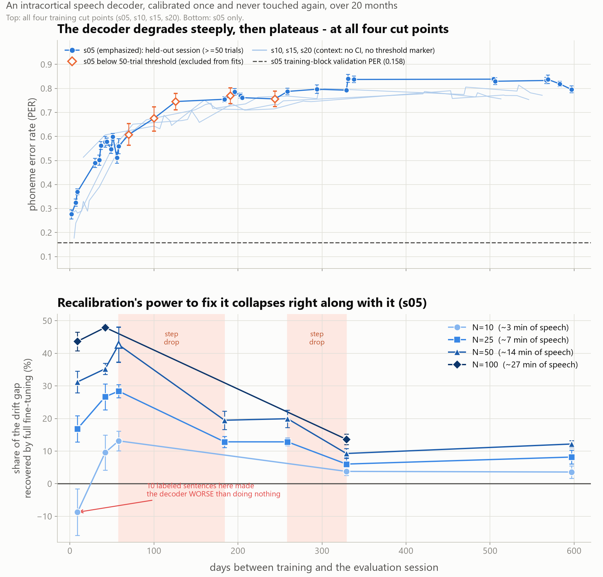

# b2t-drift

Measures how much a speech brain-computer interface (BCI) degrades when it
is calibrated once and never touched again, why, and whether a small
amount of new labeled data can fix it.

## The question

Speech BCIs decode attempted speech from neural activity in real time, and
every published system to date has relied on frequent recalibration to
stay accurate. Nobody has published what happens to a *frozen* decoder
(one calibrated on day one and never adjusted again) over the timescale
that matters for a chronic implant: months, not days. The T15
Brain-to-Text '25 dataset is, as far as I know, the only public
intracortical speech dataset that spans long enough (20 months, 45
sessions) to find out.

Three questions, in increasing order of how much they matter practically:

1. **Measurement**: how fast does decoding accuracy degrade as calibration
   data recedes into the past?
2. **Attribution**: what in the neural signal is actually changing?
3. **Decision**: given a fixed budget of a participant's time on a new
   day, what is the best use of it?

## Headline result



The decoder's accuracy collapses over the first five months and then
holds roughly flat (top); full fine-tuning on a handful of new-day
sentences recovers a large share of that loss early on, but its ceiling
falls just as sharply as the decoder itself degrades (bottom). The four
sessions below the 50-trial viability threshold (hollow markers, top) are
shown rather than dropped; they sit on the same trajectory as their
neighbors, so excluding them from the fitted statistics does not change
the curve's shape.

## What I found

| Question | Answer | Key numbers |
|---|---|---|
| **Measurement** | PER rises steeply for ~150 days, then plateaus. The shape replicates across four independently-trained cut points. | 0.277 → 0.745 over the first 126 days (s05); early/late slope ratio 15–24× (s05, s10, s15) |
| **Attribution** | Channel death is ruled out. Three mechanisms are confirmed instead: signal-to-noise loss, phoneme tuning change, and subspace rotation. All three are collinear in elapsed time, so this design cannot rank them against each other. | SNR loss: TX declines 26× faster than SBP. Tuning change: −0.056/100d, survives a healthy-channel control. Subspace rotation: 3.17°/100d, tracks PER at ρ=0.908. Pairwise \|ρ\|=0.70–0.90, falling to ≤0.32 and non-significant once elapsed time is controlled for (n=27) |
| **Decision** | Full fine-tuning wins at every elapsed time measured. It slows the decline; it does not restore day-0 function. A minimum viable calibration budget exists, below which recalibrating actively hurts. | Recovers 35–48% of accumulated drift within 2 months (N=50–100), 9–14% past 300 days. At +9 days, N=10 gives −8.8% (worse than nothing) |

(Also in `results/summary_table.csv`.)

**Measurement.** PER (phoneme error rate: edit distance between the
decoded and true phoneme sequence, the standard metric for this task
since it isolates the neural decoder from any downstream language model)
rises from 0.277 two days after calibration to 0.745 by 126 days, with no
discontinuity in between (a smooth ramp, not a step), then plateaus
around 0.80–0.84 for the remaining fifteen months. The early-vs-late
slope ratio is 15–24×, confirmed by training the same architecture at
three independent cut points in the recording (s05/s10/s15: a fourth,
s20, starts too late to observe the early climb, which is a coverage gap
in that comparison, not a contradiction of it). The best held-out PER
measured anywhere in the sweep is 0.177, five days after the largest
training block (s15). More calibration data buys a better starting
point, but not a flatter curve past the first few months.

**Attribution.** Channel death is ruled out: only 2 of 256 electrodes
crossed below a 2 Hz firing-rate floor and stayed there over 611 days,
and the trend is not significant (p=0.131). Three mechanisms are
confirmed instead. SNR loss: threshold-crossing counts (TX, a per-bin
spike count) decline 26× faster than spike-band power (SBP, continuous
power in the same band). Tuning change: the correlation between a
session's phoneme-to-channel mapping and a reference mapping decays at
−0.056/100 days, surviving a control that excludes dying or
low-firing-rate channels. Subspace rotation: the population activity
manifold rotates at 3.17°/100 days, independent of channel health, and
tracks PER as tightly as any measurement in this project (Spearman
ρ=0.908). All three are inter-correlated at \|ρ\|=0.70–0.90. Each is
also strongly monotone in elapsed time, so that correlation is expected
whether one shared process or several concurrent ones drive them: it
establishes that the three are collinear and cannot be ranked against
each other, not that a single cause produced them. Array micromotion is
the mechanism in the chronic-recording literature that would produce
all three at once, and it is the most parsimonious reading, but nothing
in this dataset measures array position.

**Decision.** Of four recalibration strategies tested (no adaptation,
unsupervised feature alignment, a small per-session input layer, and full
network fine-tuning), full fine-tuning wins at every elapsed time
measured, with one exception (below). It recovers 35–48% of the
accumulated PER gap within the first two months of drift (at 14–27
minutes of new labeled speech) and 9–14% past 300 days, using the same
budget. There is a minimum viable calibration budget, and it depends on
how much drift there is to correct: at +9 days, 10 labeled sentences make
the decoder *worse* than doing nothing at all (recovery fraction −8.8%).
On the easiest session, with the least to gain, fine-tuning on too little
data overfits to noise. At +597 days, about 15 minutes of labeled speech
buys PER 0.718 instead of 0.796. Both are unusable decoders.
**Recalibration slows the decline. It does not restore function.**

## What contradicted my predictions

Four places where the data said something different from what the
mechanism would predict: the strongest evidence in this repo that these
results were tested, not assembled to fit a story.

- **Predicted:** an SBP-only decoder would be more drift-resistant than a
  TX-only one, since SBP degrades 26× more slowly at the feature level.
  **Found:** it is not. SBP-only's PER slope is 37% *steeper* than
  TX-only's. TX and SBP are redundant views of the same underlying
  spiking activity (median per-electrode correlation 0.72, stable across
  611 days), so whatever degrades one decoder degrades the other.
- **Predicted:** subspace rotation would be correctable, since it tracks
  PER almost perfectly (ρ=0.908) and is a linear transform, which an
  unsupervised alignment method can in principle undo. **Found:**
  correcting it does not help. The benefit of an unsupervised alignment
  runs *opposite* to the rotation's magnitude. Rotation is a correlate of
  drift, not its correctable cause: a measurement can predict an outcome
  almost perfectly and still be useless as an intervention target.
- **Predicted:** a learned per-session input layer (a "day layer," a
  small affine transform fit to one session's data, standard in this
  literature) would be an essential part of the architecture. **Found:**
  the full-rank version destabilizes joint training across many sessions
  (val PER 0.332 vs. 0.169 for a much smaller version); constrained to a
  per-channel-only ("diagonal") parameterization, it is nearly free to
  omit entirely: removing a trained slice costs only −0.0004 PER.
- **Predicted:** recalibration would help most where drift is worst,
  since that's where there's the most room to recover. **Found:** its
  effectiveness falls sharply with elapsed time instead: the sessions
  with the most drift benefit the least from a fixed labeled budget.

## Limitations

- **Single participant.** Every result here is one person's brain; none
  of it supports claims about generalization across people.
- **All results are offline.** Closed-loop performance differs: a real
  user adapts to the decoder's behavior in ways this dataset cannot
  capture.
- **Speaking strategy (vocalized vs. silent attempted speech) is not
  published** and cannot be controlled for.
- **ALS progression is indistinguishable from electrode degradation** in
  this dataset: a change in PER could reflect either.
- **The three attribution mechanisms are confounded** (\|ρ\|=0.70–0.90)
  and this design cannot rank or separate them.
- **The recovery-fraction reference (0.158) is validation PER measured
  inside the training sessions**, not a true held-out day-zero session
  (an optimistic ceiling), so reported recovery fractions are lower bounds.
- **Calibration and evaluation trials are interleaved within a session**
  in the recalibration analysis, rather than calibrating first and
  decoding later as a real deployment would.
- **Sentence-level leakage** (the same sentence text appearing in both a
  calibration and an evaluation trial) affected 32 of 90 cells in the
  recalibration grid, at two sessions. Quantified and corrected: the
  effect on the headline late-session result is +0.0014 PER (sd 0.0024),
  indistinguishable from zero.
- Our pipeline's inference path reproduces the published checkpoint
  almost exactly (0.109 against their reported 0.101), but the training
  path does not reach the same scale: the official-split pipeline check
  reaches val PER 0.2211 against a pre-registered pass threshold of
  <=0.20, so it is reported as equivocal, not a pass. The first attempt
  at this diverged because a learning rate tuned at roughly 4,200
  optimizer steps does not transfer to roughly 37,800; lowering it 10x
  fixed the divergence. 0.2211 matches this project's own session-count
  trend, extrapolated to 45 sessions, to within about 1%, suggesting the
  pass threshold itself was set too tight, noted post hoc with the
  pre-registered threshold left unchanged.

## What I'd do next

- Split calibration and evaluation trials sequentially within a session
  (calibrate on the first N, evaluate on what follows) rather than
  randomly, to match a real deployment.
- Add sessions in the two elapsed-time windows where recovery fraction
  steps down sharply (currently unsampled) to see whether the drop is
  itself sudden or just under-resolved.
- Closed-loop evaluation: this dataset is offline-only and cannot
  measure how a user adapts to a degrading or freshly-recalibrated
  decoder.
- Test whether a rank-constrained day layer sits usefully between the
  diagonal parameterization's insufficiency and the full parameterization's
  training instability.
- Training was left at fp32/batch=32 throughout; a measured fp16/batch=64
  configuration runs 3.3x faster per trial (6.31 ms vs. 21.05 ms) at lower
  peak VRAM, so the compute budget for any future sweep is larger than this
  project assumed.
- Every run here used a flat, hand-tuned learning rate with no scheduler or
  warmup; a step-based schedule would likely transfer across training-set
  sizes without retuning, and would plausibly have prevented both Model A's
  divergence and the earlier Arm 2 learning-rate problem.

## Data and reproduction

This repo does not include the T15 dataset. It is human participant data
released under its own terms; it is not redistributed here.

One preprocessing detail used throughout this project, the causal
rolling per-channel z-score over the previous up-to-20 sentences, is
documented in no paper, Dryad deposit, or competition page. It was
confirmed by email with Nicholas S. Card, the corresponding author, on
2026-09-03, after two rounds of empirical inference had failed to
resolve it (see `docs/FINDINGS.md` for those attempts).

1. Download the HDF5 release from Dryad:
   https://doi.org/10.5061/dryad.dncjsxm85
2. Extract it so the layout matches:

```
data/raw/hdf5_data_final/
├── t15.2023.08.13/
│   ├── data_train.hdf5
│   ├── data_val.hdf5
│   └── data_test.hdf5
└── ... (45 session directories total)
```

```bash
uv sync --extra tensorboard   # plain `uv sync` leaves one test failing
```

| Script | What it does | Approx. runtime |
|---|---|---|
| `00_verify_data.py` | Scans the HDF5 files' attributes, builds `data/interim/session_manifest.csv` | a few minutes (metadata only, no array loads) |
| `01_build_splits.py` | Writes a versioned temporal split manifest to `splits/` | under a minute |
| `02_train.py` | Trains the GRU/CTC decoder on one cut point (e.g. s05: 908 trials, 150 epochs) | ~10 min on an RTX 2080 Super |
| `03_evaluate.py` | Scores a checkpoint on every held-out session | ~2 min (s05's 32 sessions) |
| `04_drift_curve.py` | Combines cut points into `results/drift_curve.csv` and `figures/drift_curve.png` | under a minute |

Running these four in order for the s05 cut regenerates
`results/drift_curve.csv` and `figures/drift_curve.png`, the source of
`figures/headline.png`'s top panel. The bottom panel, and the rest of the
attribution (Phase 2) and recalibration (Phase 3) analyses, used one-off
scripts kept in `scratch/` (gitignored, per this project's convention)
rather than the numbered pipeline. Those numbers are preserved in
`results/`/`figures/` and documented with method in `docs/FINDINGS.md`,
but the scripts that produced them are not part of the committed,
re-runnable pipeline: a real reproducibility gap, stated here rather
than glossed over.

## Repo layout

- `src/b2t_drift/`: library code; `scripts/`: thin CLI entry points
- `tools/`: standalone diagnostics that back specific documented figures
  (e.g. padding waste, GPU step time/VRAM), distinct from `scripts/`'s
  numbered pipeline
- `splits/`: versioned session split manifests; `results/` / `figures/`:
  versioned numeric results and plots
- `docs/DESIGN.md`: current decisions and their justification, no
  chronology
- `docs/FINDINGS.md`: the dated, append-only record of every
  investigation and what it found
- `docs/DATASET.md`: facts about the dataset itself

## Citation

This project builds on:

> Card, N.S. *et al.* "An Accurate and Rapidly Calibrating Speech
> Neuroprosthesis." *New England Journal of Medicine* 391(7):609–618,
> 2024. https://doi.org/10.1056/NEJMoa2314132

Data: T15 Brain-to-Text '25, released via Dryad
(https://doi.org/10.5061/dryad.dncjsxm85) for the
[Brain-to-Text '25 competition](https://www.kaggle.com/competitions/brain-to-text-25).
The dataset is human participant data with its own license and is **not
redistributed in this repository**.
